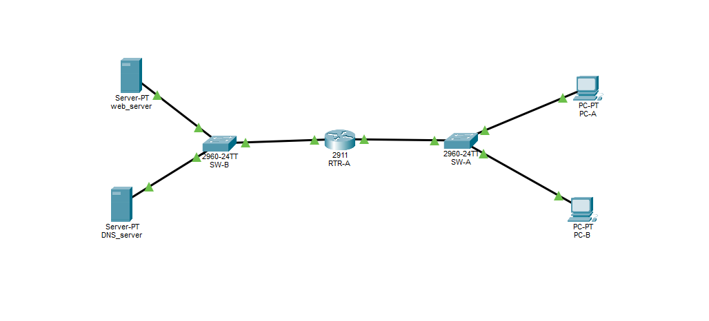
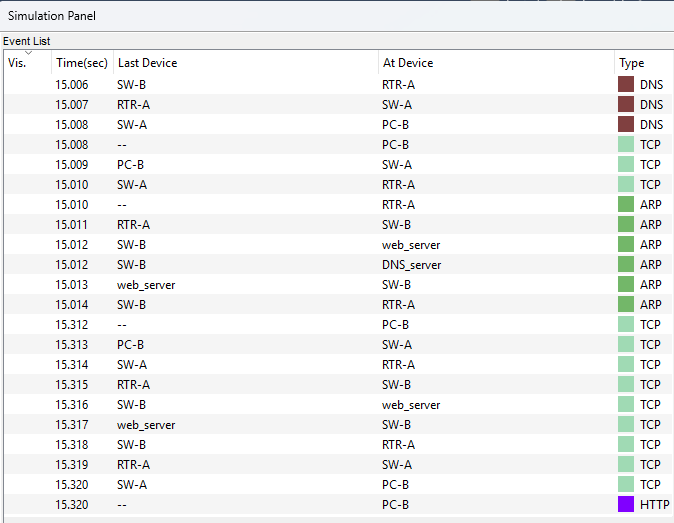

# 🌐 Fundamentos de Redes & Anatomia de Pacotes (Cisco Networking Basics)

Este diretório reune minhas notas estruturadas dos **17 módulos do curso Networking Basics da Cisco** e um laboratório prático construído no **Cisco Packet Tracer** demonstrando o fluxo completo de um pacote na rede (`DHCP` ➔ `DNS` ➔ `ARP` ➔ `Roteamento` ➔ `NAT/PAT` ➔ `TCP 3-Way Handshake` ➔ `HTTP`).

---

## 📚 Notas Estruturadas dos 17 Módulos (Cisco Networking Academy)

| Módulo | Documento de Notas |
| :--- | :--- |
| **Módulo 01** — A Comunicação em um Mundo Conectado | [📄 Modulo-1.md](./notes/Modulo-1.md) |
| **Módulo 02** — Componentes, Tipos e Conexões de Rede | [📄 Modulo-2.md](./notes/Modulo-2.md) |
| **Módulo 03** — Redes sem Fio e Móveis | [📄 Modulo-3.md](./notes/Modulo-3.md) |
| **Módulo 04** — Construção de uma Rede Doméstica | [📄 Modulo-4.md](./notes/Modulo-4.md) |
| **Módulo 05** — Princípios de Comunicação em Rede | [📄 Modulo-5.md](./notes/Modulo-5.md) |
| **Módulo 06** — Meios Físicos de Rede | [📄 Modulo-6.md](./notes/Modulo-6.md) |
| **Módulo 07** — Controle de Acesso ao Meio | [📄 Modulo-7.md](./notes/Modulo-7.md) |
| **Módulo 08** — O Protocolo Ethernet e Switches L2 | [📄 Modulo-8.md](./notes/Modulo-8.md) |
| **Módulo 09** — A Camada de Rede e Roteamento | [📄 Modulo-9.md](./notes/Modulo-9.md) |
| **Módulo 10** — Endereçamento IPv4 e Sub-redes | [📄 Modulo-10.md](./notes/Modulo-10.md) |
| **Módulo 11** — Endereçamento IPv6 | [📄 Modulo-11.md](./notes/Modulo-11.md) |
| **Módulo 12** — Alocação Dinâmica de Endereços (DHCP) | [📄 Modulo-12.md](./notes/Modulo-12.md) |
| **Módulo 13** — Protocolos ARP e ND (Descoberta de Vizinhos) | [📄 Modulo-13.md](./notes/Modulo-13.md) |
| **Módulo 14** — A Camada de Transporte (TCP e UDP) | [📄 Modulo-14.md](./notes/Modulo-14.md) |
| **Módulo 15** — Serviços da Camada de Aplicação (DNS, HTTP) | [📄 Modulo-15.md](./notes/Modulo-15.md) |
| **Módulo 16** — Fundamentos de Segurança de Rede | [📄 Modulo-16.md](./notes/Modulo-16.md) |
| **Módulo 17** — Testes e Troubleshooting de Rede | [📄 Modulo-17.md](./notes/Modulo-17.md) |

---

## 🛠️ Laboratório Prático: Análise de Fluxo de Pacotes (`.pkt`)

📂 **Arquivo executável do Packet Tracer:** [`network-packet-flow.pkt`](./packet-tracer/network-packet-flow.pkt)

### 1. Arquitetura e Tabela de Endereçamento


A topologia simula uma rede interna de clientes (`LAN`) isolada de uma rede externa de serviços (`WAN/DMZ`), interconectadas por um roteador Cisco 2911 (`RTR-A`) responsável pelo serviço de **DHCP**, **Roteamento** e **NAT Overload (PAT)**:

| Dispositivo | Interface | Endereço IPv4 | Máscara | Default Gateway | Papel na Topologia |
| :--- | :--- | :--- | :--- | :--- | :--- |
| **`RTR-A` (2911)** | `Gig0/0` (`inside`) | `192.168.1.1` | `/24` (`255.255.255.0`) | — | Gateway da LAN + Servidor DHCP |
| **`RTR-A` (2911)** | `Gig0/1` (`outside`) | `200.10.10.1` | `/24` (`255.255.255.0`) | — | Interface externa com NAT Overload (PAT) |
| **`SW-A` (2960)** | Portas `Fa0/x` | Camada 2 | — | — | Comutação de quadros da LAN de Clientes |
| **`PC-A`** | `FastEthernet0` | `192.168.1.10` *(DHCP)* | `/24` (`255.255.255.0`) | `192.168.1.1` | Host cliente na rede local |
| **`PC-B`** | `FastEthernet0` | `192.168.1.11` *(DHCP)* | `/24` (`255.255.255.0`) | `192.168.1.1` | Host cliente que origina a requisição |
| **`SW-B` (2960)** | Portas `Fa0/x` | Camada 2 | — | — | Comutação de quadros na rede de Servidores |
| **`DNS_server`** | `FastEthernet0` | `200.10.10.3` *(Estático)*| `/24` (`255.255.255.0`) | `200.10.10.1` | Servidor DNS (`webserver.lab` ➔ `200.10.10.2`) |
| **`web_server`** | `FastEthernet0` | `200.10.10.2` *(Estático)*| `/24` (`255.255.255.0`) | `200.10.10.1` | Servidor HTTP (Porta 80/TCP) |

---

### 2. Passo a Passo do Fluxo do Pacote (`http://webserver.lab`)

Ao acessar `http://webserver.lab` a partir do navegador do **`PC-B`**, o ciclo completo de comunicação ocorre na seguinte ordem:

#### 🔹 Etapa 1: Concessão de Endereço via DHCP (DORA)
Antes de iniciar qualquer comunicação, os hosts `PC-A` e `PC-B` obtêm suas configurações de rede dinamicamente através do pool `LAN_CLIENTES` configurado no `RTR-A`, recebendo IP na sub-rede `192.168.1.0/24`, Default Gateway (`192.168.1.1`) e o IP do servidor DNS (`200.10.10.3`).

#### 🔹 Etapa 2: Geração da Query DNS e ARP na Rede Local (LAN)
1. O `PC-B` precisa resolver o domínio `webserver.lab` e cria um pacote **DNS Query (UDP Porta 53)** com IP de destino `200.10.10.3`.
2. Como o IP `200.10.10.3` pertence a outra rede, o `PC-B` deve encaminhar o quadro ao seu **Default Gateway (`192.168.1.1`)**.
3. Caso o endereço MAC do `RTR-A` não esteja em seu cache ARP, o `PC-B` coloca o pacote DNS em espera (*buffer*) e dispara um **ARP Request em Broadcast (`FFFF.FFFF.FFFF`)** para o `SW-A`.
4. O `SW-A` inunda o broadcast para todas as portas (`PC-A` descarta o pacote, enquanto o `RTR-A` reconhece seu IP e devolve um **ARP Reply em Unicast** para o `PC-B`).

#### 🔹 Etapa 3: Roteamento, NAT Overload (PAT) e ARP na Rede de Servidores
1. Com o MAC do gateway resolvido, o `PC-B` envia o pacote DNS até a interface `Gig0/0` (`ip nat inside`) do `RTR-A`.
2. O `RTR-A` desencapsula o quadro Ethernet, consulta sua tabela de roteamento (`show ip route`) e aplica a regra de **PAT (NAT Overload)** na saída `Gig0/1` (`ip nat outside`), traduzindo o IP privado de origem (`192.168.1.11:porta`) para o IP público da interface externa (`200.10.10.1:porta`).
3. Para entregar o pacote na rede `200.10.10.0/24`, o `RTR-A` executa um **ARP Request** através do `SW-B` para descobrir o MAC do `DNS_server` (`200.10.10.3`), recebe o **ARP Reply** e encaminha a query DNS.
4. O `DNS_server` responde com o **DNS Response** contendo o IP `200.10.10.2`. O `RTR-A` consulta sua tabela de traduções NAT, desfaz a tradução para `192.168.1.11` e devolve a resposta ao `PC-B`.

#### 🔹 Etapa 4: TCP Three-Way Handshake e Transferência HTTP
Agora que o `PC-B` conhece o IP do `web_server` (`200.10.10.2`), ele inicia a conexão confiável na camada de transporte (**TCP Porta 80**):
1. **`SYN`**: O `PC-B` envia o segmento inicial com a flag `SYN` ativa (caso o `RTR-A` ainda não possua o MAC do `web_server`, ocorre o ciclo de `ARP Request/Reply` entre `RTR-A` e `web_server`).
2. **`SYN-ACK`**: O `web_server` responde confirmando o sincronismo (`SYN + ACK`).
3. **`ACK`**: O `PC-B` envia a confirmação final. Com a sessão `ESTABLISHED`, o navegador envia imediatamente a requisição **`HTTP GET`**, e o `web_server` devolve o conteúdo HTML da página.



---

### 3. Configuração Aplicada no Roteador (`RTR-A`)

```ios
hostname RTR-A
!
ip dhcp excluded-address 192.168.1.1 192.168.1.9
ip dhcp pool LAN_CLIENTES
 network 192.168.1.0 255.255.255.0
 default-router 192.168.1.1
 dns-server 200.10.10.3
!
interface GigabitEthernet0/0
 ip address 192.168.1.1 255.255.255.0
 ip nat inside
 no shutdown
!
interface GigabitEthernet0/1
 ip address 200.10.10.1 255.255.255.0
 ip nat outside
 no shutdown
!
access-list 1 permit 192.168.1.0 0.0.0.255
ip nat inside source list 1 interface GigabitEthernet0/1 overload
